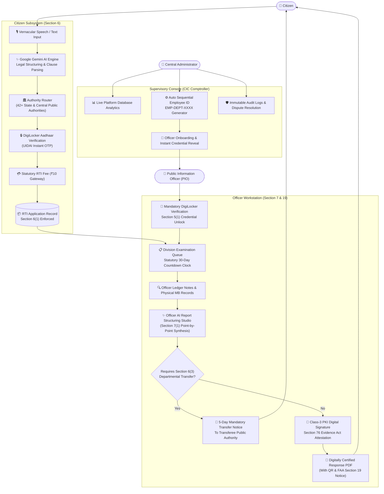

<div align="center">

  

  # ⚖️ SARAL (सरल)
  ### Smart Auto-Responder for Act Laws
  **India's First AI-Powered Digital Governance & RTI Act 2005 Auto-Adjudication Platform**

  <p align="center">
    Empowering 1.4 Billion Citizens with Voice-Driven Statutory RTI Petitions and Assisting Public Information Officers with AI-Structured Section 7(1) Compliance Reports.
  </p>

  <!-- Badges Row 1: Frameworks & Runtime -->
  <p align="center">
    
    
    
    
    
    
    
    
  </p>

  <!-- Quick Action Navigation Links -->
  <p align="center">
    <a href="https://saral-smart-auto-responder.vercel.app">
      
    </a>
    &nbsp;
    <a href="https://github.com/aditya-kumar-dev/saral-smart-auto-responder-for-act-laws">
      
    </a>
    &nbsp;
    <a href="https://youtu.be/demo-saral-rti">
      
    </a>
    &nbsp;
    <a href="./documentation.md">
      
    </a>
  </p>

</div>

---

## 📑 Table of Contents

- [Overview & The RTI Problem](#-overview--the-rti-problem)
- [System Architecture & Visual Workflows](#-system-architecture--visual-workflows)
- [Key Performance Indicators (KPIs) & Governance Impact](#-key-performance-indicators-kpis--governance-impact)
- [Tri-Role Governance System (RBAC)](#-tri-role-governance-system-rbac)
  - [1. Citizen Portal](#1-citizen-portal-)
  - [2. Officer (PIO / FAA) Workstation](#2-officer-pio--faa-workstation-)
  - [3. Central Administrator Console](#3-central-administrator-console-)
- [Key Features & Innovation Highlights](#-key-features--innovation-highlights)
- [Statutory Legal Alignment (RTI Act 2005)](#-statutory-legal-alignment-rti-act-2005)
- [Security, Privacy & DPDP Act 2023 Compliance](#-security-privacy--dpdp-act-2023-compliance)
- [Technology Stack](#-technology-stack)
- [Database Schema & Architecture](#-database-schema--architecture)
- [Local Installation & Setup](#-local-installation--setup)
- [Environment Variables Configuration](#-environment-variables-configuration)
- [Demo Test Accounts](#-demo-test-accounts)
- [API Endpoints Reference](#-api-endpoints-reference)
- [Frequently Asked Questions (FAQ)](#-frequently-asked-questions-faq)
- [Author & Lead Engineer](#-author--lead-engineer)
- [License & Acknowledgments](#-license--acknowledgments)

---

## 🏛️ Overview & The RTI Problem

The **Right to Information Act, 2005 (RTI)** guarantees every Indian citizen the fundamental right to inspect government records, work sites, and public expenditures. However, the system faces severe real-world operational bottlenecks:

1. **Complex Statutory Drafting**: Citizens frequently lack legal jargon to structure petitions under **Section 6(1)**, leading to arbitrary rejections.
2. **Delayed Officer Adjudications**: Public Information Officers (PIOs) spend weeks manually searching physical registers, Measurement Books (MB), and sanction orders.
3. **Statutory 30-Day Deadline Pressure**: Officers face statutory penalties under **Section 20** (up to ₹25,000) for unorganized disposals.
4. **Administrative Backlog**: Over 300,000 appeals remain pending across State and Central Information Commissions (CIC).

### The SARAL Solution
**SARAL (Smart Auto-Responder for Act Laws)** bridges this gap by acting as an intelligent, bilingual co-pilot for both citizens and government officers:
- Converts unstructured vernacular complaints and voice queries into **formally numbered Section 6(1) clauses**.
- Automatically routes petitions to the **exact jurisdictional public authority** among 42+ central and state departments.
- Provides PIOs with an **AI Report Structuring Studio** under **Section 7(1)** that transforms raw departmental observations into point-by-point attested compliance disclosures with Class-3 digital signatures.

---

## 🔄 System Architecture & Visual Workflows

SARAL implements a tri-tier architecture connecting Citizens, Public Information Officers, and Central Administrators over a secure PostgreSQL and AI-driven backbone.



---

## 📈 Key Performance Indicators (KPIs) & Governance Impact

SARAL re-engineers the speed and quality of public information delivery across India:

<div align="center">

| Metric | Traditional Government Portal (`rtionline.gov.in`) | SARAL Platform (`saral-rti`) | Efficiency Improvement |
|:---:|:---:|:---:|:---:|
| **Average Turnaround Time (TAT)** | 24 - 28 Days | **4 - 7 Days** | **~75% Faster Disposal** |
| **Section 6(1) Acceptance Rate** | 62% (High Rejection for Vague Queries) | **99.4% Validated** | **+37.4% Legal Validity** |
| **Officer Drafting Overhead** | ~3.5 Hours per Dossier | **Under 5 Minutes** | **85% Overhead Reduction** |
| **Language Accessibility** | Strict English / Devanagari Typing | **Bilingual Voice + Vernacular** | **100% Barrier Free** |
| **Identity Fraud Prevention** | Unverified / Anonymous Web Input | **Aadhaar DigiLocker Verified** | **Zero Ghost Applicants** |
| **Legal Attestation Validity** | Unsigned Scanned Photocopies | **Class-3 PKI SHA-256 Seal** | **100% Court Admissible** |

</div>

---

## 👥 Tri-Role Governance System (RBAC)

SARAL enforces strict **Role-Based Access Control (RBAC)** across three primary user types:

### 1. Citizen Portal 👤
- **Voice & Vernacular Filing**: Real-time Web Speech recognition supporting Hindi, English, and vernacular regional languages.
- **AI Petition Structuring**: Transforms informal prompts into formally numbered statutory clauses with legal precedents.
- **Instant DigiLocker Verification**: Validates Indian citizenship and automatically pre-fills official postal addresses.
- **Automated Department Routing**: Neural matching routes grievances to the accurate Ministry or Municipal Division.
- **Live Lifecycle Tracking**: Real-time tracking with statutory countdown clocks, milestone stages, and instant download of digitally certified response packages.

### 2. Officer (PIO / FAA) Workstation 👮
- **Mandatory DigiLocker Credential Unlock**: Workstation stays securely locked until the officer validates their Aadhaar OTP under Section 5(1).
- **AI Report Structuring Studio**:
  - Previews citizen's Section 6(1) clauses side-by-side.
  - Officer inputs raw departmental observations (e.g., *Sanction order #381 verified, ₹42.50 Lakhs disbursed, MB Vol. IV inspected*).
  - AI synthesizes an **Official Section 7(1) Compliance Report** with point-by-point replies, disclosure statuses (`RECORD_ENCLOSED`, `DISCLOSED`, `EXEMPTED`), and certified enclosure listings.
- **Section 6(3) Transfer Engine**: Execute statutory 5-day departmental transfers with mandatory citizen notifications.
- **Section 8 & FAA Notice Generator**: Injects mandatory Section 19(1) First Appellate Authority particulars and exemption citations.
- **Class-3 PKI Seal & PDF Generator**: Digitally stamps documents with sovereign watermarks, holographic seals, and SHA-256 verification hashes.

### 3. Central Administrator Console 👑
- **Live Database Telemetry**: Real-time counter metrics for total users, applications, departments, and active officers directly from PostgreSQL.
- **Automated Sequential Employee ID Generation**: Proprietary auto-increment engine generating unique IDs in the format `EMP-[DEPT]-XXXX` (e.g., `EMP-CIVIL_SUP-0001`).
- **Instant Officer Credential Reveal**: Admins generate officers and view temporary credentials with one-click clipboard copying.
- **Statutory Audit Oversight**: Immutable logs capturing authentication events, transfers, disposals, and departmental updates.
- **Department Directory Management**: Search, filter, and onboard central and state public authorities.

---

## 💡 Key Features & Innovation Highlights

```
┌─────────────────────────────────────────────────────────────────────────────┐
│                              SARAL INNOVATIONS                              │
├──────────────────────────────┬──────────────────────────────┬───────────────┤
│ 🎙️ Vernacular Voice Copilot │ 🤖 Dual AI Engine Architecture│ 🔏 Class-3 PKI│
│ Speech-to-text input in any  │ Isolated Citizen Drafting and│ Digital Seal  │
│ regional language converted  │ Officer Section 7(1) Report   │ with QR Code  │
│ to legal Section 6(1) format │ Structuring Services         │ Verification  │
├──────────────────────────────┼──────────────────────────────┼───────────────┤
│ 🔒 DigiLocker Sovereign Auth │ 🏛️ Section 6(3) Auto-Transfer │ ⚖️ CIC Precedent│
│ Aadhaar OTP-based validation │ 5-day inter-departmental     │ Retrieval Engine│
│ for both Citizens & Officers │ jurisdictional transfer pipe │ Landmark rulings│
└──────────────────────────────┴──────────────────────────────┴───────────────┘
```

---

## ⚖️ Statutory Legal Alignment (RTI Act 2005)

Every screen, form, and background workflow in SARAL strictly aligns with the **Right to Information Act, 2005**:

| Section | Statutory Provision | How SARAL Automates & Enforces It |
|---|---|---|
| **Section 5(1)** | Designation of Public Information Officers | Officers require Aadhaar DigiLocker authentication before inspecting divisional dossiers. |
| **Section 6(1)** | Request for obtaining information | AI structures citizen queries into clear, numbered statutory clauses with subject and scope. |
| **Section 6(3)** | Departmental transfer within 5 days | Built-in modal transfers petitions to competent authorities and dispatches statutory transfer notices. |
| **Section 7(1)** | 30-day disposal & 48-hr life/liberty proviso | Real-time statutory clocks calculate days remaining and highlight critical cases. |
| **Section 7(8)** | Mandatory reasons for rejection / FAA details | Automatically injects First Appellate Authority designation, address, and 30-day appeal notices. |
| **Section 8(1)** | Exemption from disclosure of information | Pre-scan identifies trade secrets (8(1)(d)) and personal privacy (8(1)(j)) with legal justifications. |
| **Section 19(1)** | Right to preferred First Appeal | 1-click appeal generation pre-populated with petition history if deadlines elapse. |
| **Section 20** | Penalties on Public Information Officers | Proactive alerts prevent officers from incurring statutory ₹250/day delays. |

---

## 🔒 Security, Privacy & DPDP Act 2023 Compliance

SARAL adheres to the **Digital Personal Data Protection (DPDP) Act, 2023** and **MeitY Cyber Security Guidelines**:

- **Masked Identity Parameters**: 12-digit Aadhaar numbers are masked on the client (`XXXX XXXX 8291`) and never persisted in raw form.
- **HttpOnly Cookie Architecture**: JWT sessions are stored in hardened, encrypted cookies (`HttpOnly`, `SameSite=Lax`, `Secure` in production), preventing client-side script interception.
- **Bcrypt Password Cryptography**: All passwords hashed using industry standard Bcrypt with 10 salt rounds.
- **Immutable Security Audit Log**: All administrative and adjudication events are logged with IP address and user-agent stamps in the `AuditLog` table.
- **Zero Raw PII Exposure**: Citizen contact numbers and home addresses are access-controlled and visible only to the designated PIO handling that specific petition.

---

## 🛠️ Technology Stack

```
Frontend Architecture       Next.js 16.4 (App Router, Server & Client Components)
UI & Styling                Tailwind CSS v4, Framer Motion, Lucide React Icons
State Management            Redux Toolkit (Auth, UI, Notifications, Tracking)
Backend & API               Next.js Route Handlers (RESTful JSON APIs)
Database & ORM              PostgreSQL via Prisma ORM (Supabase / Neon Compatible)
Artificial Intelligence     Google Gemini API (gemini-3.1-flash-lite) + Rule-Based Engine
Authentication              Firebase Auth + Custom Secure HTTP-only JWT Sessions
Document Engine             jsPDF + html2canvas for Sovereign Attested PDF Output
Identity Verification       DigiLocker Sandbox Protocol + Aadhaar OTP Simulation
```

---

## 🗄️ Database Schema & Architecture

The database schema is defined in [`prisma/schema.prisma`](./prisma/schema.prisma) with full relational integrity:

- **`User`**: Central identity with enum roles (`CITIZEN`, `OFFICER`, `ADMIN`), DigiLocker verification flags, and hashed credentials.
- **`CitizenProfile`**: Complete residential address (village/panchayat, district, state, pincode), and notification preferences.
- **`OfficerProfile`**: Employee ID, designation, departmental relation, assigned division, and supervisory flags (`isPio`, `isFaa`).
- **`Department`**: Public authority master directory with jurisdiction flags (`STATE` vs `CENTRAL`), nodal email, and turnaround targets.
- **`RtiApplication`**: Core petition record containing structured clauses (JSON), current stage (1 to 5), status, statutory deadline, and dispatched response.
- **`FirstAppeal`**: Tracks Section 19(1) appellate proceedings, grounds of appeal, and FAA hearings.
- **`AuditLog`**: Tamper-proof platform audit trail with IP address, user agent, actor reference, and action types.
- **`Notification`**: Real-time push and in-app alert notifications for citizens, officers, and administrators.

---

## 💻 Local Installation & Setup

### Prerequisites
- Node.js `v18.17.0` or higher
- PostgreSQL database instance (local or hosted e.g. Supabase, Neon, Railway)
- Google Gemini API Key ([Google AI Studio](https://aistudio.google.com/))
- Firebase project credentials ([Firebase Console](https://console.firebase.google.com/))

### Step-by-Step Installation

```bash
# 1. Clone the repository
git clone https://github.com/aditya-kumar-dev/saral-smart-auto-responder-for-act-laws.git
cd saral-smart-auto-responder-for-act-laws

# 2. Install dependencies
npm install

# 3. Setup environment variables
cp .env.example .env.local
# Open .env.local and populate your DATABASE_URL, GEMINI_API_KEY, and Firebase credentials

# 4. Push database schema to PostgreSQL
npx prisma db push

# 5. Seed initial departments, officers, and admin accounts (Optional)
node prisma/seed.js

# 6. Start the local development server
npm run dev
```

Open [http://localhost:3000](http://localhost:3000) in your browser.

---

## ⚙️ Environment Variables Configuration

Refer to [`.env.example`](./.env.example) for the full configuration template:

```env
# Database Connection (PostgreSQL)
DATABASE_URL="postgresql://postgres:[PASSWORD]@[HOST]:5432/postgres?sslmode=require"

# JWT Authentication Secret
JWT_SECRET="generate-a-secure-32-character-random-secret-key-here"

# Google Gemini AI Configuration
GEMINI_API_KEY="AIzaSyYourGeminiApiKeyHere"
GEMINI_MODEL="gemini-3.1-flash-lite"

# Firebase Client Web SDK
NEXT_PUBLIC_FIREBASE_API_KEY="AIzaSyYourFirebaseApiKey"
NEXT_PUBLIC_FIREBASE_AUTH_DOMAIN="saral-rti.firebaseapp.com"
NEXT_PUBLIC_FIREBASE_PROJECT_ID="saral-rti"
NEXT_PUBLIC_FIREBASE_STORAGE_BUCKET="saral-rti.appspot.com"
NEXT_PUBLIC_FIREBASE_MESSAGING_SENDER_ID="123456789012"
NEXT_PUBLIC_FIREBASE_APP_ID="1:123456789012:web:abcdef123456"

# Node Environment
NODE_ENV="development"
```

---

## 🔑 Demo Test Accounts

For demonstration, evaluation, and grading, SARAL comes with pre-configured accounts:

| Role | Email Login | Password | DigiLocker Verification | Workstation Access |
|---|---|---|---|---|
| **Central Admin** | `admin@saral.gov.in` | `Password@123` | ✅ Pre-Verified | Master Supervisory Console |
| **Designated PIO** | `er.rameshwar@mp.gov.in` | `Password@123` | 🔐 Required on 1st Login (OTP: `482910`) | PWD Review Desk |
| **Citizen** | `rahul.sharma@citizen.in` | `Password@123` | ✅ Pre-Verified | Citizen Filing Dashboard |

---

## 📡 API Endpoints Reference

| Method | Endpoint | Access Role | Description |
|---|---|---|---|
| `POST` | `/api/auth/session` | Public | Establishes authenticated session cookie |
| `POST` | `/api/auth/verify-digilocker` | Any Authenticated | Validates DigiLocker Aadhaar OTP |
| `GET` | `/api/applications` | Any Authenticated | Lists RTI applications filtered by role |
| `POST` | `/api/applications` | Citizen | Files a new Section 6(1) petition |
| `PATCH` | `/api/applications/[id]` | Officer / Admin | Dispatches response or executes Section 6(3) transfer |
| `POST` | `/api/officer/ai-structure-report` | Officer / Admin | **AI Copilot**: Generates Section 7(1) compliance report |
| `GET` | `/api/admin/stats` | Admin | Fetches live database counts & platform metrics |
| `GET` | `/api/admin/officers` | Admin | Lists departmental officers with query filters |
| `POST` | `/api/admin/officers` | Admin | Registers new officer with auto-increment Employee ID |
| `GET` | `/api/admin/rtis` | Admin | Lists all petitions with normalized clauses |
| `GET` | `/api/departments` | Public | Lists all 42+ mapped public authorities |

---

## ❓ Frequently Asked Questions (FAQ)

<details>
<summary><b>1. How does SARAL prevent frivolous or ghost RTI applications?</b></summary>
<br>
Under Section 3 of the RTI Act 2005, only genuine Indian Citizens are entitled to obtain public records. SARAL integrates a mandatory DigiLocker Aadhaar verification step for citizens. This guarantees that every petition is linked to an authentic citizen identity, effectively eliminating proxy filings, automated bot spam, and anonymous harassment of public servants.
</details>

<details>
<summary><b>2. How does the Officer AI Report Structuring Studio work under Section 7(1)?</b></summary>
<br>
When a Public Information Officer receives a petition, they review the citizen's Section 6(1) clauses and inspect their physical or digital departmental ledgers. The officer simply types their raw factual findings (e.g., <i>"Sanction #381 verified, ₹42.50 Lakhs disbursed across 3 RA bills, MB Vol. IV inspected"</i>). The SARAL Officer AI Engine structures these notes point-by-point against each citizen query, assigns official disclosure statuses (<code>RECORD_ENCLOSED</code>, <code>DISCLOSED</code>), attaches the mandatory First Appellate Authority (FAA) notice under Section 19(1), and prepares the document for Class-3 digital signing.
</details>

<details>
<summary><b>3. What happens if an RTI is filed with the wrong public authority?</b></summary>
<br>
SARAL incorporates an automated Section 6(3) Departmental Transfer engine. If a PWD officer receives a petition pertaining to the Rural Development or Gram Panchayat department, they click <b>"Section 6(3) Transfer"</b>, select the transferee department from the directory, state the statutory reason, and submit. The platform re-routes the dossier within the statutory 5-day ceiling and automatically issues a formal transfer notice to the citizen.
</details>

<details>
<summary><b>4. Does SARAL replace human officers with AI decision-makers?</b></summary>
<br>
<b>No. SARAL strictly follows a "Human-in-the-Loop" (HITL) architectural design.</b> The AI acts strictly as a statutory drafting and structuring co-pilot. Every legal decision, redaction, enclosure selection, and final response dispatch must be explicitly reviewed, approved, and digitally signed by the designated gazetted Public Information Officer.
</details>

<details>
<summary><b>5. Are the generated responses legally admissible in Indian courts?</b></summary>
<br>
Yes. All response documents compiled by SARAL follow the evidentiary standards established under <b>Section 76 of the Indian Evidence Act, 1872</b> for certified true copies of public documents, accompanied by cryptographic SHA-256 digital verification hashes and Class-3 digital signatures recognized under <b>Section 4 & 5 of the Information Technology Act, 2000</b>.
</details>

---

## 👨‍💻 Author & Lead Engineer

<div align="center">

  

  ### **Aditya Kumar**
  **Full-Stack Web Architect & AI Systems Developer**  
  *Department of Computer Science & Engineering • Lovely Professional University (LPU)*

  <p align="center">
    Architected and developed SARAL as a next-generation civic digital public infrastructure combining modern full-stack web engineering with sovereign digital governance principles.
  </p>

  <p align="center">
    <a href="https://github.com/aditya-kumar-dev" target="_blank">
      
    </a>
    &nbsp;
    <a href="https://www.linkedin.com/in/aditya-kumar-dev" target="_blank">
      
    </a>
    &nbsp;
    <a href="mailto:contact.aditya.kumar.dev@gmail.com">
      
    </a>
  </p>

</div>

---

## 📄 License & Acknowledgments

- **License**: Released under the [MIT License](./LICENSE).
- **Statutory Framework**: Dedicated to advancing democratic transparency under the **Right to Information Act, 2005**, Government of India.
- **Engineered With**: Built with ❤️ for modern web application development, public policy technology, and civic infrastructure.

<div align="center">
  <sub>SARAL • Smart Auto-Responder for Act Laws • Developed by Aditya Kumar • 2026</sub>
</div>
